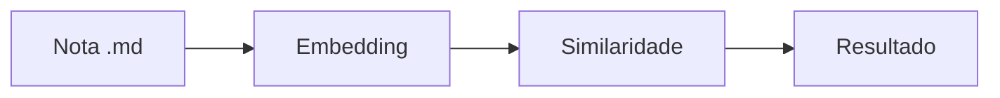

# Panorama do VellumMD

Notas em **Markdown puro**, recuperadas pelo *significado*. A relevância vem da
similaridade do cosseno:

$$ sim(a,b) = \frac{a \cdot b}{\|a\| \, \|b\|} $$

| Recurso | Estado |
|---|---|
| Fórmulas (KaTeX) | pronto |
| Diagramas (Mermaid) | pronto |
| Busca semântica | pronto |

- [x] Índice local em `.vellum`
- [ ] Sincronização entre dispositivos

Relacionado: [[Busca Semantica]] · [[Segundo Cerebro]]
