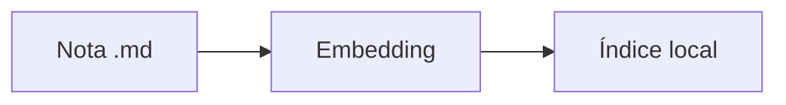

# VellumMD

Notas locais, busca por significado

---

## O problema

- O volume de notas cresce
- A busca por palavra exata falha
- A nota existe, mas não é reencontrada

---

## A proposta

$$ sim(a,b) = \frac{a \cdot b}{\|a\| \, \|b\|} $$

Recuperação por proximidade de sentido.

---

## Arquitetura

---

## Resultado

| Antes | Depois |
|---|---|
| Palavra exata | Significado |
| Nuvem | Disco local |
