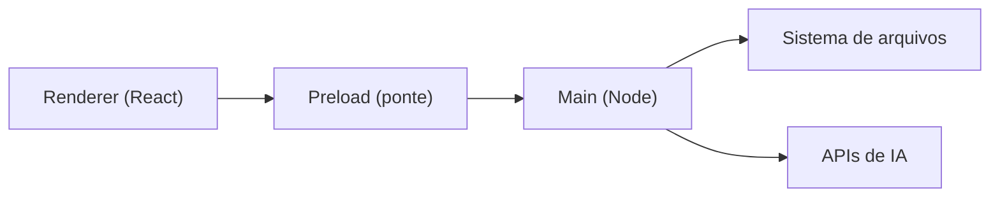

# Arquitetura

Três processos isolados: a interface não toca o disco diretamente.

| Processo | Responsabilidade |
|---|---|
| Renderer | Interface e edição |
| Preload | Canais autorizados |
| Main | Disco, janelas, exportação |

> [!WARNING]
> Sem a ponte, uma página remota herdaria acesso ao disco.

Ver [[Busca Semantica]].
