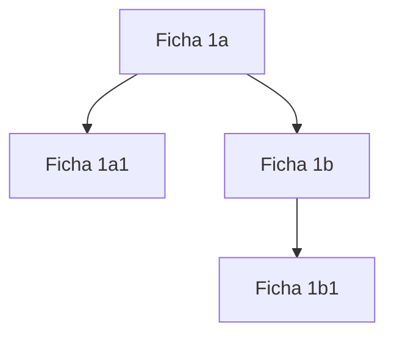

# Zettelkasten

Método de fichas de Niklas Luhmann: cada ficha recebe um identificador e liga-se
a outras, formando uma rede que cresce por associação.

Três regras bastam:

1. Uma ideia por ficha
2. Texto com palavras próprias
3. Ligação explícita com ao menos uma ficha anterior

É a origem prática do [[Segundo Cerebro]] e de [[Notas Atomicas]].
